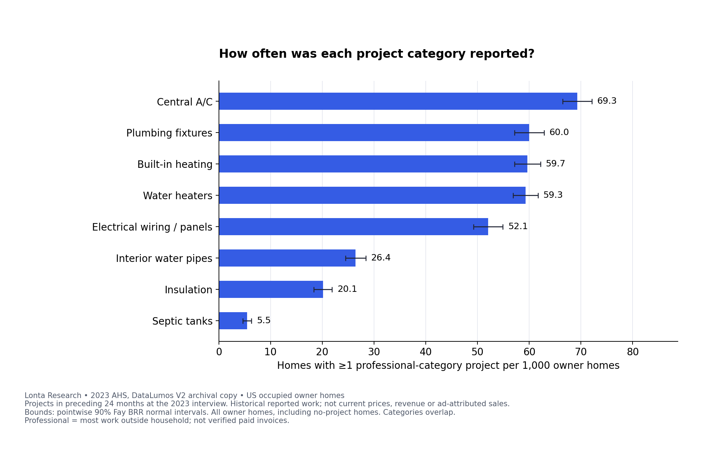
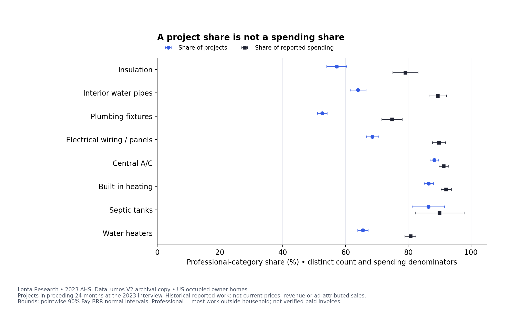
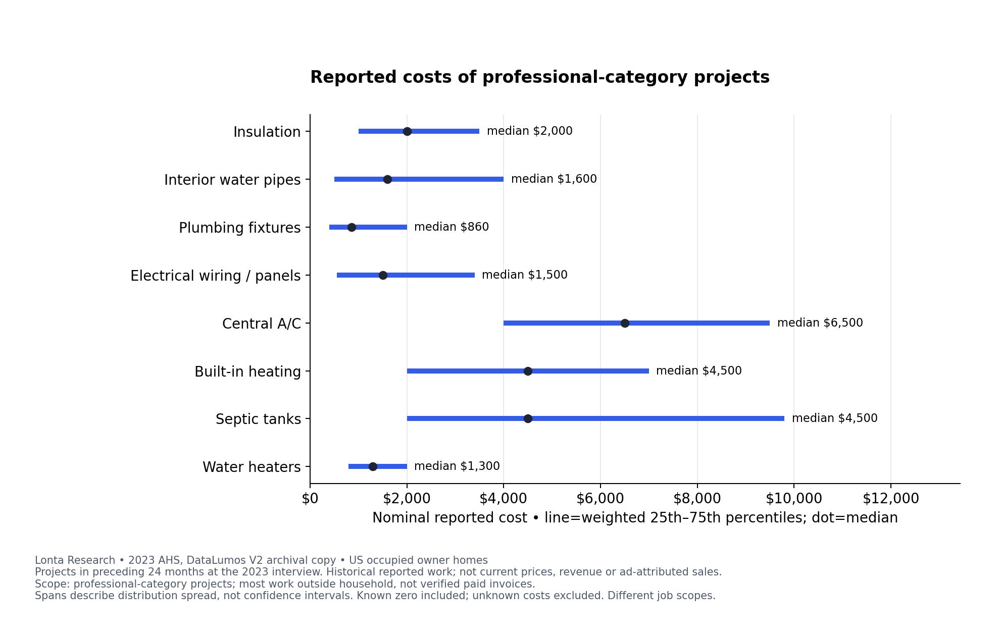
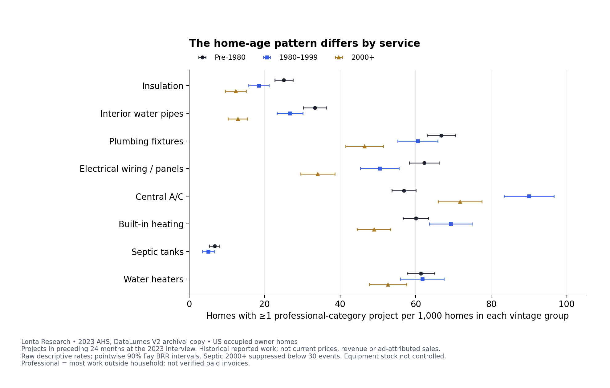

# Reusable figure embeds

Download and unpack the latest editorial kit. Open one of the four `embed-*.html` files in this folder to preview its figure and complete credit line. The images are local files in `../figures/`, so the preview needs no third-party script, iframe or hotlinked image.

For a CMS article, upload the chosen PNG to your own media library, replace the relative `src` below with its CMS URL, and paste the figure/caption HTML. Keep the population, period, definitions and credit with the figure. You can edit the wording and redraw a chart; name modifications and keep the source context. Attribution does not require a particular link attribute.

Company-authored Lonta analysis prepared with OpenAI Codex. Original figures and captions: CC BY 4.0. Source-data rights remain separate. The original v1 ZIP is retained unchanged; v1.1 adds this portable presentation, a concise PDF and a separate blank planning workbook. It does not add survey results.

## 01-project-frequency

[Preview with local image](embed-01-project-frequency.html). Upload its PNG from `figures/` to your CMS and replace `src` before publishing.

```html
<figure>
  
  <figcaption>
    Estimated homes with at least one professional-category project per 1,000 occupied owner homes, by service category. The denominator includes homes reporting no project. Categories overlap and should not be added. Bounds show pointwise 90% Fay BRR intervals. Historical reported work is not a local lead forecast.
    US occupied owner homes, preceding 24 months at the 2023 interview. Professional category means most work outside the household, not verified paid invoices.
    Source: <a href="https://lonta.io/research/home-service-demand/">Lonta AI analysis</a> of Census/HUD's 2023 American Housing Survey,
    <a href="https://doi.org/10.3886/E217661V2">DataLumos 217661/V2</a>. Prepared with OpenAI Codex. Original figure: CC BY 4.0.
  </figcaption>
</figure>
```

## 02-project-spending-shares

[Preview with local image](embed-02-project-spending-shares.html). Upload its PNG from `figures/` to your CMS and replace `src` before publishing.

```html
<figure>
  
  <figcaption>
    The professional-category share of project counts and of known reported spending use separate denominators. For plumbing fixtures, the estimated shares are 52.6% and 74.8%. Bounds show pointwise 90% Fay BRR intervals. The spending measure covers reported outlays with varying scope and materials, not contractor revenue or profit.
    US occupied owner homes, preceding 24 months at the 2023 interview. Professional category means most work outside the household, not verified paid invoices.
    Source: <a href="https://lonta.io/research/home-service-demand/">Lonta AI analysis</a> of Census/HUD's 2023 American Housing Survey,
    <a href="https://doi.org/10.3886/E217661V2">DataLumos 217661/V2</a>. Prepared with OpenAI Codex. Original figure: CC BY 4.0.
  </figcaption>
</figure>
```

## 03-cost-distributions

[Preview with local image](embed-03-cost-distributions.html). Upload its PNG from `figures/` to your CMS and replace `src` before publishing.

```html
<figure>
  
  <figcaption>
    For professional-category projects with known nonnegative costs, dots show weighted medians and horizontal spans show first-to-third quartiles. The spans describe the middle half of each reported-outlay distribution, not confidence intervals. The central A/C median is $6,500 and its quartile span is $4,000–$9,500. Nominal historical outlays are not current local quotes or margins.
    US occupied owner homes, preceding 24 months at the 2023 interview. Professional category means most work outside the household, not verified paid invoices.
    Source: <a href="https://lonta.io/research/home-service-demand/">Lonta AI analysis</a> of Census/HUD's 2023 American Housing Survey,
    <a href="https://doi.org/10.3886/E217661V2">DataLumos 217661/V2</a>. Prepared with OpenAI Codex. Original figure: CC BY 4.0.
  </figcaption>
</figure>
```

## 04-home-vintage

[Preview with local image](embed-04-home-vintage.html). Upload its PNG from `figures/` to your CMS and replace `src` before publishing.

```html
<figure>
  
  <figcaption>
    Raw rates of homes with at least one professional-category project per 1,000 occupied owner homes in three construction-vintage groups. Central A/C rates are 56.9 for pre-1980, 90.0 for 1980–1999 and 71.7 for 2000+. Bounds show pointwise 90% Fay BRR intervals. The septic 2000+ cell is withheld for reliability. Equipment stock is uncontrolled, and home construction year is not equipment age.
    US occupied owner homes, preceding 24 months at the 2023 interview. Professional category means most work outside the household, not verified paid invoices.
    Source: <a href="https://lonta.io/research/home-service-demand/">Lonta AI analysis</a> of Census/HUD's 2023 American Housing Survey,
    <a href="https://doi.org/10.3886/E217661V2">DataLumos 217661/V2</a>. Prepared with OpenAI Codex. Original figure: CC BY 4.0.
  </figcaption>
</figure>
```

